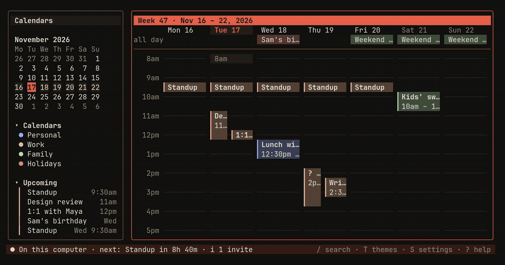
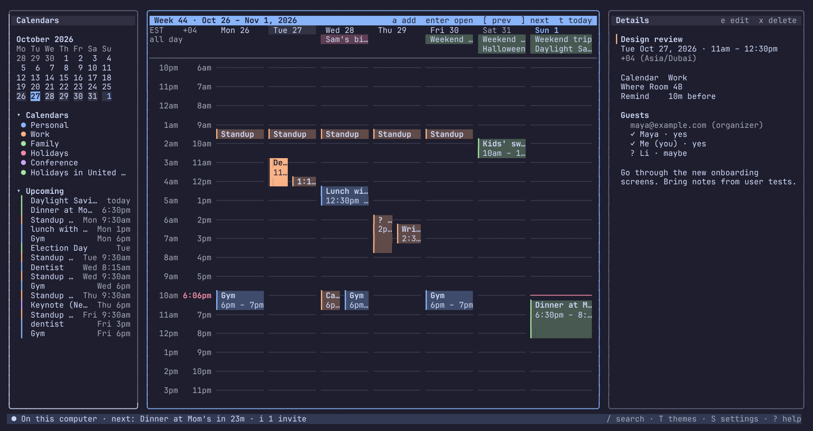
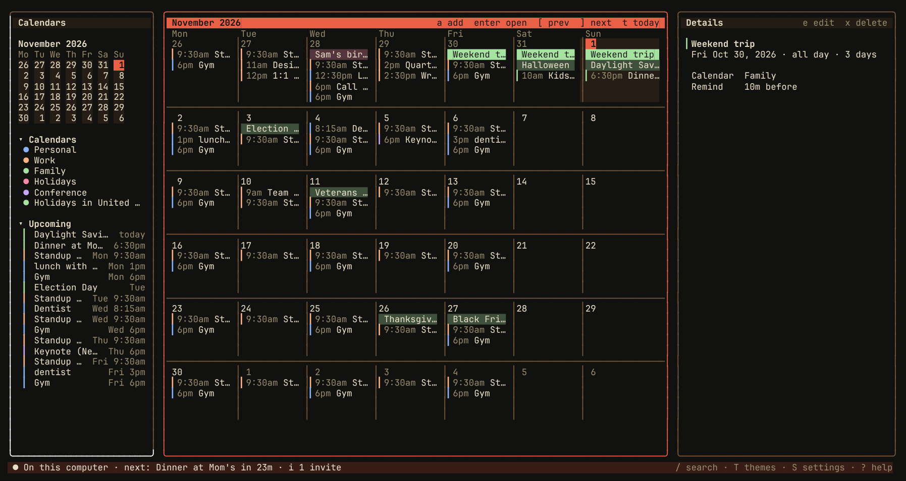
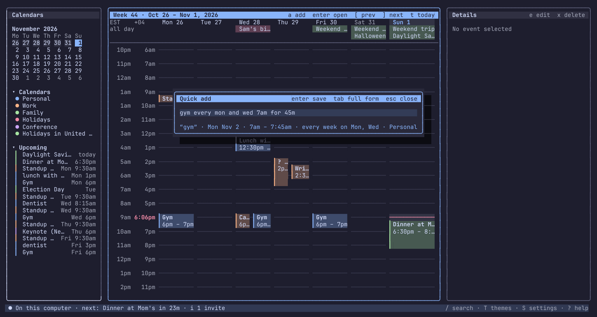
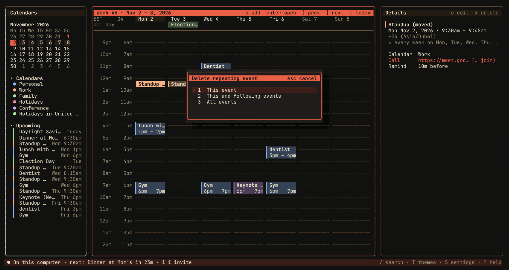
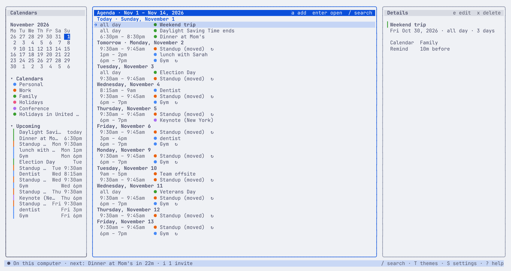

# Calinator

A modern calendar for the terminal. Made for [Omarchy](https://omarchy.org), works on any Linux desktop.





- **Day, week, month and agenda views.** Overlapping events sit side by side; a red line shows the time now.
- **Quick add in plain words:** `lunch with Sarah tomorrow 1pm`, `gym every mon and wed 7am for 45m`, `trip dec 24 all day`.
- **Repeating events done right:** change or delete *this event*, *this and following* or *all events*.
- **Time zones:** events keep their own zone and show in yours. A second zone column if you want one. Correct across DST.
- **Reminders** as desktop notifications, also when the app is closed.
- **Invites:** answer yes / maybe / no. Before guests get an email, Calinator asks you.
- **Looks like your desktop:** many themes plus *Match Omarchy*, which follows your Omarchy theme live. Every theme passes a contrast test.
- **Keyboard first,** mouse works too. Every key can be changed. Every setting is in the app.
- **For scripts, bars and AI agents:** a CLI with JSON output and `calinator --bar`.
- **.ics files and webcal links:** import a file, or subscribe to a link (refreshed every hour).

- **Two-way sync** with Google, iCloud and any CalDAV server (Fastmail, Nextcloud, Radicale). Works offline; nothing is lost when both sides change.

## Install

**Install script** (no sudo; puts `calinator` in `~/.local/bin` and adds a desktop entry):

```bash
curl -fsSL https://raw.githubusercontent.com/smanookian/calinator/main/install.sh | sh
```

**From source:**

```bash
git clone https://github.com/smanookian/calinator && cd calinator && ./install.sh
```

**Arch (AUR):** `yay -S calinator-bin`

Then run `calinator`. Check your setup with `calinator doctor`.

**Reminders with the app closed:** `calinator daemon --install` (a systemd user service).

## Keys

Press `?` in the app for all keys. Change any key in Settings (`S`) → Keys.

| Key | Action |
|-----|--------|
| `h` `l` | previous / next day |
| `j` `k` | later / earlier (week, day), next / previous week (month) |
| `}` `{` | next / previous event |
| `d` `w` `m` `g` | day / week / month / agenda view |
| `t` | today |
| `[` `]` | previous / next week or month |
| `G` | go to a date |
| `a` | quick add · `A` full form |
| `enter` | open event · `e` edit · `x` delete |
| `J` | join the video call |
| `i` | invites: `y` yes, `m` maybe, `n` no |
| `/` | search events |
| `tab` | next pane; in the left pane `space` shows / hides a calendar |
| `T` · `S` · `?` | themes · settings · help |
| `@` | accounts · `s` sync now · `!` sync conflicts |
| `q` | quit |





## Command line

Every command takes `--json` for scripts and agents.

```bash
calinator agenda --days 3
calinator events list --from today --to fri --json
calinator events create "dentist fri 3pm-4pm"
calinator events delete ID --start 2026-11-02T09:30:00+04:00 --scope following
calinator search dentist
calinator calendars
calinator import invite.ics                    # add events from a file
calinator import webcal://example.com/team.ics # subscribe (read-only)
calinator doctor
```

## Accounts and sync

Press `@` to add an account. Changes sync both ways about every 30 seconds while the app is open, and right after you change something. With the reminder service on (`calinator daemon --install`) they also sync when the app is closed.

- **iCloud:** make an app-specific password at [account.apple.com](https://account.apple.com) (Sign-In and Security → App-Specific Passwords), then enter your Apple ID and that password.
- **CalDAV** (Fastmail, Nextcloud, mailbox.org, Radicale…): the server address, your user name and password.
- **Google:** sign in once in the browser. While Calinator's Google app is waiting for Google's review, you see a "Google hasn't verified this app" page: click Advanced → Go to Calinator.

Passwords and sign-ins live in the system keyring, never in Calinator's files. Calendar data goes only between your computer and your calendar service.

**Offline?** Changes wait and go up later. **Changed in two places?** The server's version wins, and yours is kept: press `!` to see it and bring it back.

```bash
calinator accounts                                   # list accounts and their state
echo "$PASSWORD" | calinator accounts add caldav https://caldav.fastmail.com you@fastmail.com
calinator sync                                       # sync now
```

## Omarchy bar / Waybar

Add a module to `~/.config/waybar/config.jsonc`:

```jsonc
"custom/calinator": {
  "exec": "calinator --bar",
  "return-type": "json",
  "interval": 60,
  "on-click": "xdg-terminal-exec calinator"
}
```

It shows the next event with a countdown; the tooltip lists today. Classes: `now`, `soon` (15 minutes or less), `later`, `none`. Turn it off in Settings → Show in Omarchy bar.

## Files

- Calendar data: `~/.local/share/calinator/calinator.db` (use another with `--db FILE`).
- Settings and keys live in the same file, so the app, the CLI and the reminder service agree.

## Build and test

```bash
cargo test                       # repeating events, time zones and DST, quick add, keys, contrast for every theme
XDG_DATA_HOME=/tmp/cal-demo cargo run --example demo   # sample events for trying the app
XDG_DATA_HOME=/tmp/cal-demo cargo run
```

## License

MIT. All libraries are MIT, Apache-2.0 or similar; none are GPL.
